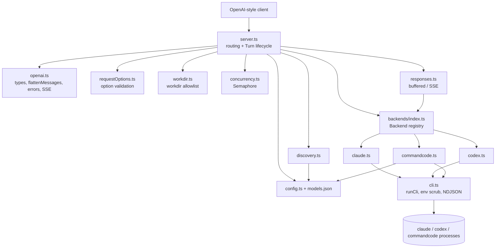
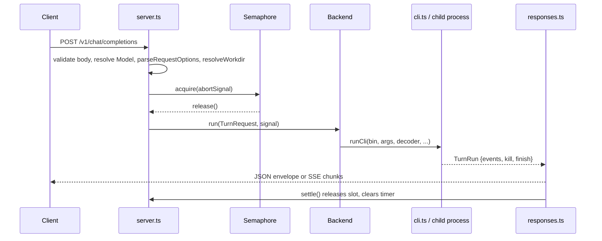

# localAIWrapper

## Purpose

localAIWrapper is a zero-dependency Bun/TypeScript HTTP server (`package.json`, `src/server.ts`) that exposes an **OpenAI-compatible API** on top of locally installed, subscription-authenticated coding-agent CLIs: `claude`, `codex` and `commandcode`. Each request ("Turn") spawns a CLI process, decodes its NDJSON output and returns it as a `chat.completion` JSON envelope or an SSE stream. Credentials that would cause API billing are stripped from the child environment, so the signed-in plan answers.

Endpoints:

| Endpoint | Handler |
|---|---|
| `GET /health` | `server.ts` |
| `POST /v1/chat/completions` | `handleChatCompletions` in `src/server.ts` |
| `GET /v1/models`, `GET /v1/models/{id}` | `src/discovery.ts` |
| `GET /v1/commandcode/models` | `src/discovery.ts` + `src/backends/commandcode.ts` |

Tool calling (`tools`, `functions`, `tool_choice`) is deliberately rejected with a 400.

## Architecture

### Request flow

## Components

### Server and lifecycle — `src/server.ts`, `src/concurrency.ts`
`server.ts` routes requests, validates them and owns the Turn lifecycle. One `AbortController` spans queue wait and process runtime and fires on client disconnect (`req.signal`) or timeout (`TURN_TIMEOUT_MS`, default 10 min). `Semaphore` (`MAX_CONCURRENCY`, default 4) queues requests FIFO; a queued request whose signal aborts rejects with `AbortedWhileQueuedError` and never takes a slot. Bun's `idleTimeout` is set to 255s so slow first tokens do not drop streams.

### Configuration — `src/config.ts`, `models.json`
`models.json` declares the Models (`claude-opus/sonnet/haiku`, `codex-sol/terra/luna`) with backend, CLI model name, system prompt and `contextWindow`. `config.ts` validates it at boot (unknown keys/backends fail), and merges per-backend option declarations (`BACKEND_OPTION_DEFAULTS`) for `reasoning_effort`, `web`, `access` and `workdir`. It also reads `WORKDIR_DEFAULT`, `WORKDIR_ROOTS`, `MAX_CONCURRENCY` and `TURN_TIMEOUT_MS`. `commandcode` Models are not in `models.json`; they are resolved live per request.

### Request handling — `src/openai.ts`, `src/requestOptions.ts`, `src/workdir.ts`
- `openai.ts`: OpenAI types, `flattenMessages` (system messages joined; the rest becomes a `Human:`/`Assistant:` transcript), `checkMessages`, `sseFrame`, `errorResponse`.
- `requestOptions.ts`: pure validation of per-request options against the Model's declared `ModelOptions`. Unsupported options accept only their neutral value; `response_format` supports `text` and `json_schema`.
- `workdir.ts`: `resolveWorkdir` checks realpath containment in `WORKDIR_ROOTS`; every filesystem-dependent rejection returns the same message so clients cannot probe paths.

### Backends — `src/backends/`
The `Backend` interface (`index.ts`) has `label`, `streaming`, `jsonSchema` and `run(req, signal): TurnRun`. Only the backend file knows its binary, flags and billing env vars.

| File | CLI | Streaming | JSON schema | Notes |
|---|---|---|---|---|
| `claude.ts` | `claude` | yes | yes (`--json-schema`) | `stream-json` + partial messages; `toolsFor` maps `access`/`web` to `--tools`; separates text across tool calls; treats `is_error`/`terminal_reason` as failures even if `subtype` is "success" |
| `codex.ts` | `codex exec -` | no (one chunk) | yes (temp schema file, cleaned up) | sandbox from `access`; `web_search` set explicitly; unwraps JSON-encoded errors |
| `commandcode.ts` | `commandcode` | yes | no | model catalog read from CLI cache or `--list-models`; resolves `commandcode/<id or short name>`; never passes `--yolo`, so read-only |
| `cli.ts` | shared | | | `runCli` spawns with scrubbed env (`childEnvironment`), writes prompt to stdin, reads NDJSON via `readLines`/`jsonLineDecoder`, drains stderr, kills on abort; `finish()` reports exit code and stderr tail |

The prompt always goes on stdin, never argv. Access tools are not a sandbox (reads can leave the workdir).

### Responses — `src/responses.ts`
`bufferedResponse` consumes events to the end and returns a `chat.completion` (504 on timeout, 502 on backend error). `streamResponse` emits `chat.completion.chunk` SSE frames, sends the terminal line's text only if no deltas were sent, always appends a usage chunk when known, reports mid-stream errors as a final content delta, and kills the process on client cancel. `settle()` is called exactly once.

### Discovery — `src/discovery.ts`
Builds `/v1/models` entries from config and the backend registry, with a `local_ai_wrapper` block (backend, llm, `streaming`, `tools:false`, `options`, optional `contextWindow`). `commandcodeModelList` formats the live catalog with optional `q` filtering.

### Build and test tooling
- `package.json`: `start` (`bun run src/server.ts`), `typecheck` (`tsc --noEmit`), `test:unit` (`bun test test/`), `test` (unit + `./test.sh`). No dependencies.
- `tsconfig.json`: strict, `noUncheckedIndexedAccess`, no emit, `types: []`.
- `src/bun-env.d.ts`: hand-written ambient declarations for Bun and Node built-ins, avoiding `bun-types`/`@types/node`.
- `test.sh`: live smoke test that starts the server on a spare port with bogus API keys (verifying env scrubbing), then exercises discovery, guards, workdir/access, structured output, streaming, timeout and concurrency. It makes real, billable CLI calls.

## Key design points
- CLI-only transport (see `docs/adr/0007`); commandcode live pass-through (`docs/adr/0008`).
- Stateless: each request resends full history, flattened into one prompt.
- Process safety: concurrency cap, timeout, client-disconnect kill, orphan-free `finish()`.
- Billing safety: API-key and parent-session variables are removed from child environments.

No sub-module pages were generated: the module is a single cohesive unit whose parts are described above.
